# 基于 SpringBoot+Vue 的视频分享平台的设计与实现

> 本文围绕一个基于 SpringBoot+Vue 的前后端分离视频分享平台展开，详细介绍了管理员端与用户端的功能设计、技术选型及核心业务流程。

## 一、项目背景

- 本平台适用于视频内容创作与分发场景，注册用户可上传、观看、互动视频内容。
- 解决视频内容从上传到审核再到展示的流程管理问题，同时支持分类、公告、轮播等运营功能。
- 满足管理员对内容审核、用户管理、数据运营的需求，为用户提供完整的视频观看与社交互动体验。

## 二、功能模块介绍

系统分为两个端：**管理员端** 与 **用户端**。管理员负责后台运营与审核，用户负责内容生产与消费。

| 系统端 | 角色 | 职责说明 |
| --- | --- | --- |
| 管理员端 | 管理员 | 登录后台，管理视频分类、轮播图、公告、审核视频、管理用户与评论数据 |
| 用户端 | 注册用户 | 登录后浏览视频、观看、点赞、评论、收藏、上传视频，管理个人中心 |

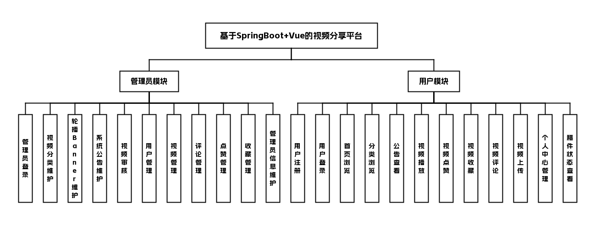

## 三、技术栈说明

前端：Vue 2、Element UI

后端：Java 8、Spring Boot、MyBatis-Plus、Druid

数据库与中间件：MySQL

## 四、核心模块介绍

###### 管理员端

###### 管理员

- 后台账号登录，与普通用户入口分离
- 维护视频分类、轮播 Banner、系统公告
- 对用户上传视频做审核（待审→通过或驳回），控制前台是否展示
- 管理前台用户、视频、评论及点赞、收藏等数据
- 维护后台管理员信息

##### 界面展示

登录页：管理员输入账号密码登录后台

轮播图管理页：维护平台轮播图，支持增删改操作

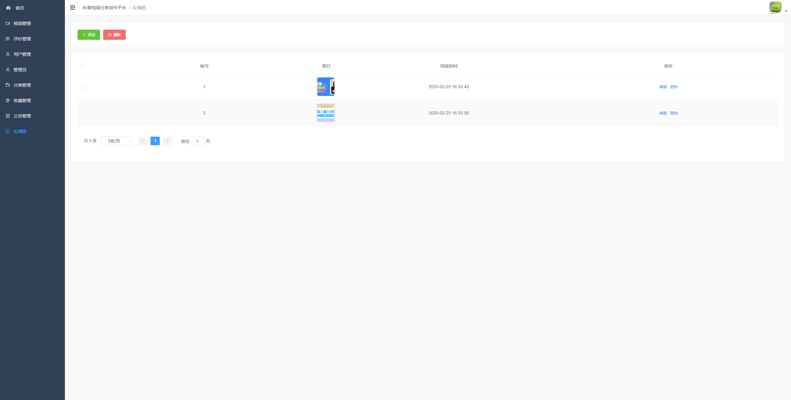

分类管理页：对科普视频的分类信息进行管理

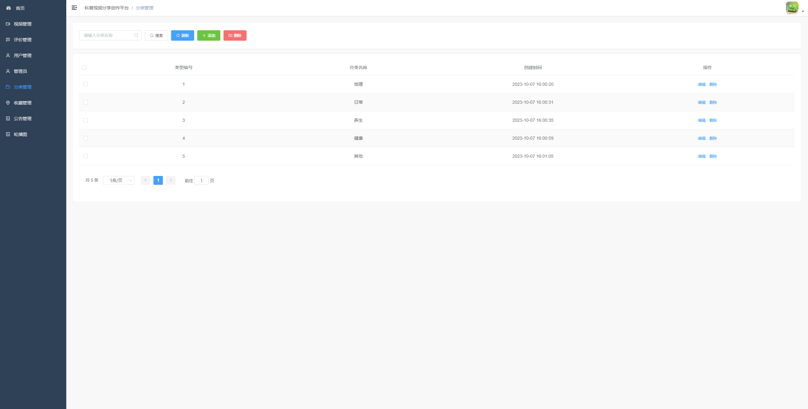

公告管理页：管理员查看、编辑、删除平台系统公告

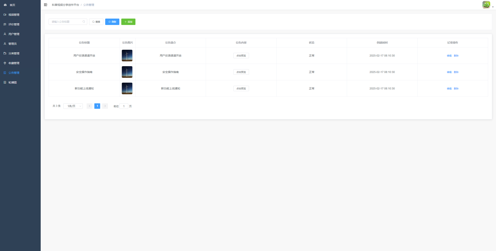

公告管理页：修改平台系统公告的内容及相关信息

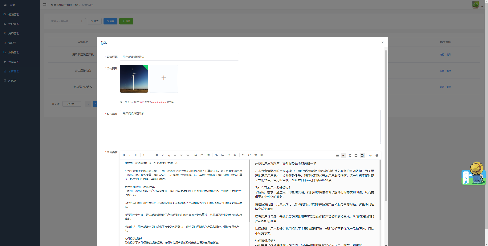

视频管理页：对平台用户上传的视频进行管理与审核

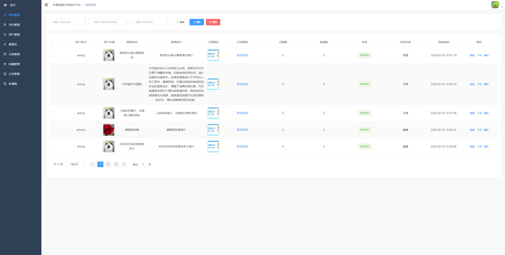

评论管理页：管理员查看并管理平台的用户评论

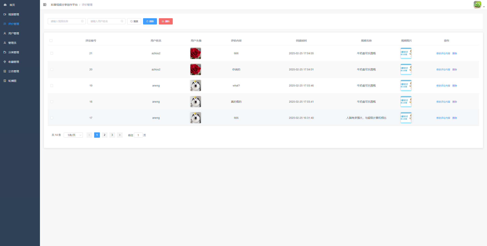

收藏管理页：管理员查看并管理平台内的用户收藏数据

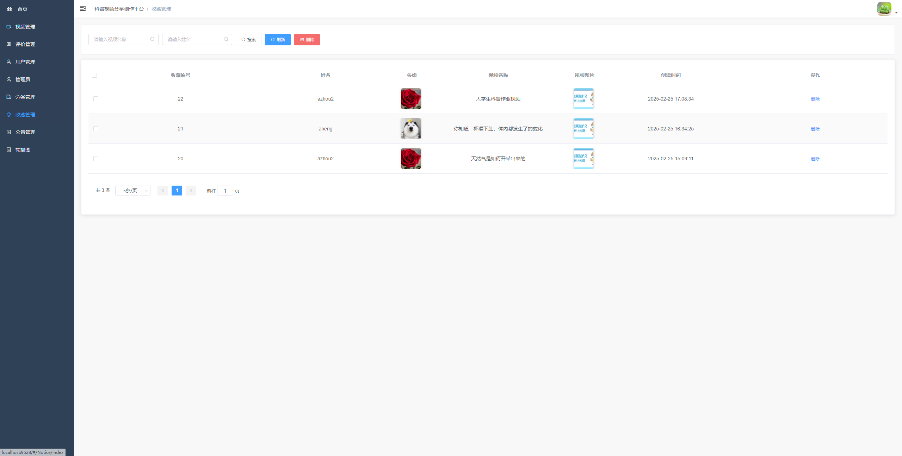

###### 用户端

###### 注册用户

- 注册、登录后浏览首页、分类与公告
- 观看视频详情并播放，可进行点赞、收藏、评论
- 上传视频默认进入审核中，通过后参与列表排序展示
- 个人中心维护资料并查看稿件审核状态

##### 界面展示

注册页：填写信息，完成科普视频平台账号注册

登录页：用户输入账号密码登录科普视频分享创作平台

首页：展示轮播和推荐科普视频，供用户浏览

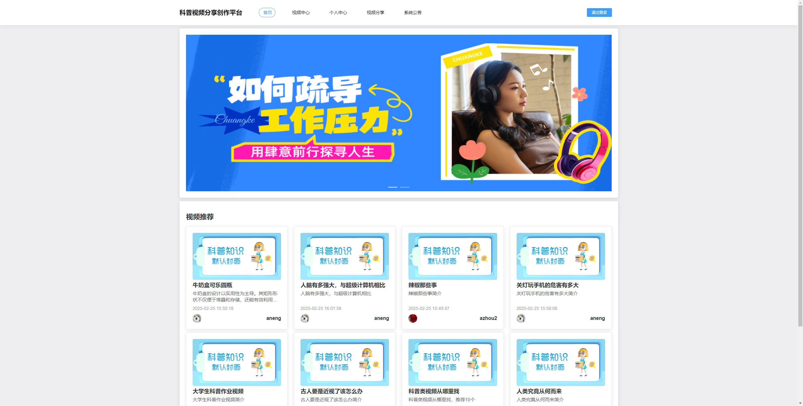

公告列表页：浏览平台发布的所有系统公告

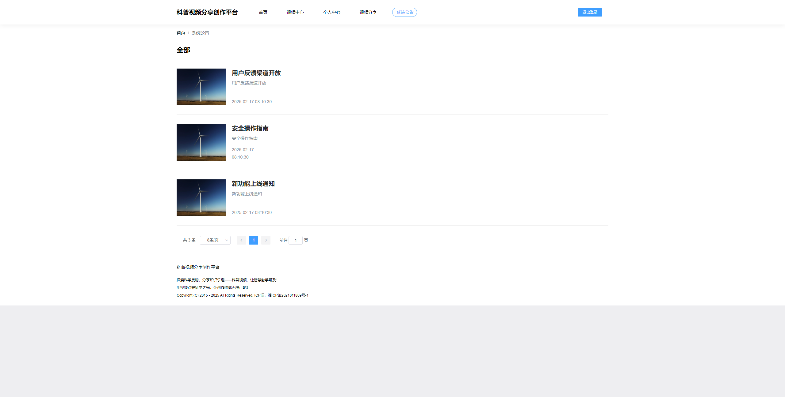

公告详情页：展示开放用户反馈渠道的公告详情

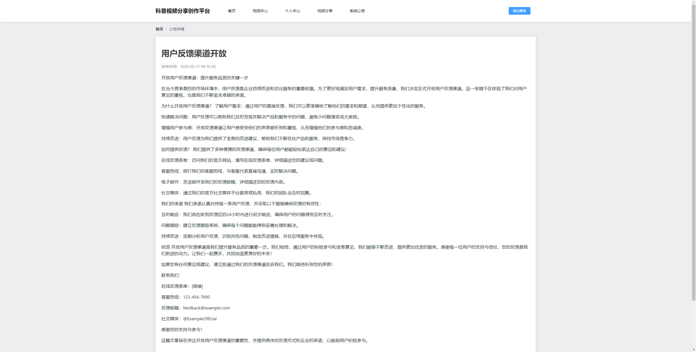

视频列表页：按分类浏览科普视频，支持搜索筛选

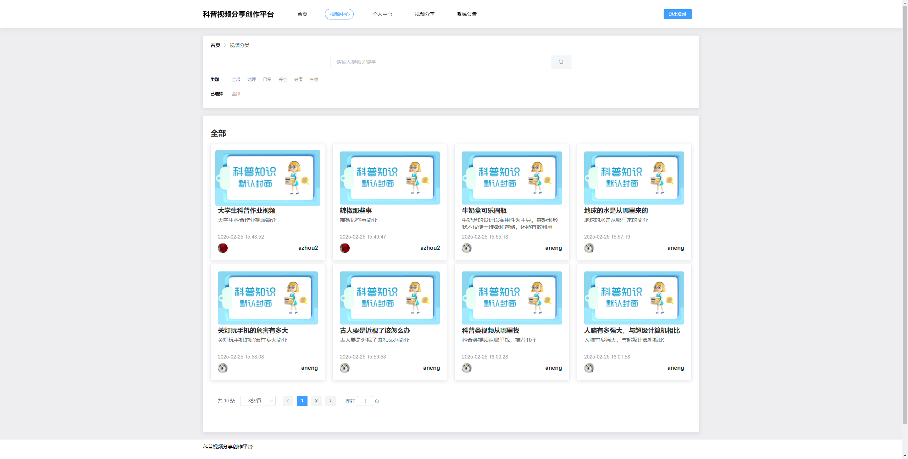

视频详情页：展示视频详情，支持用户评论互动

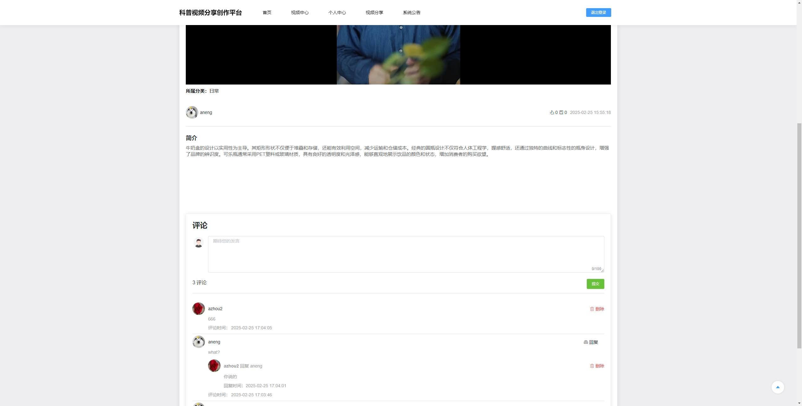

视频详情页：用户观看科普视频，查看视频详情内容

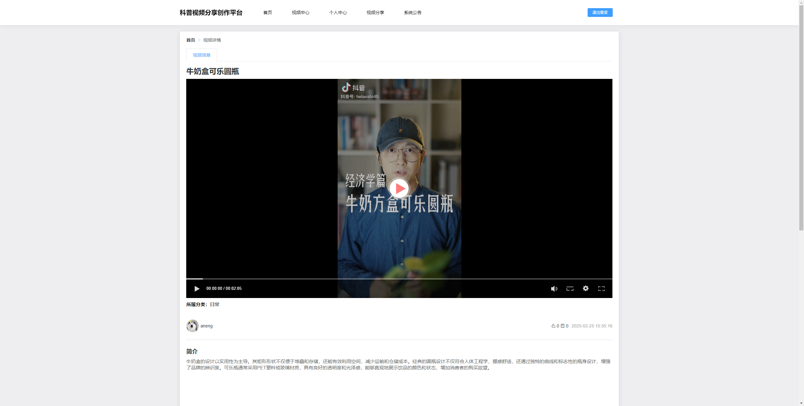

视频发布页：填写视频信息，提交上传待审核视频

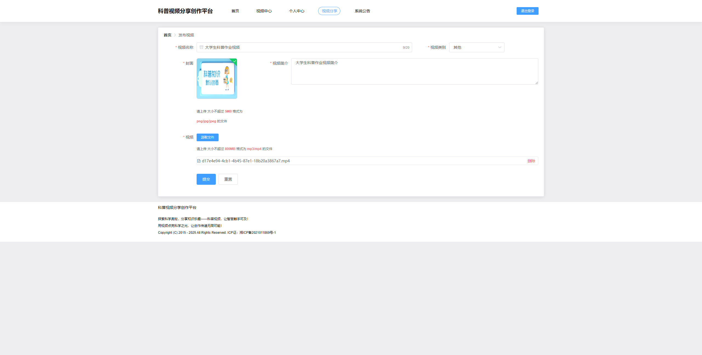

我的发布：查看个人发布视频及审核状态，可编辑删除

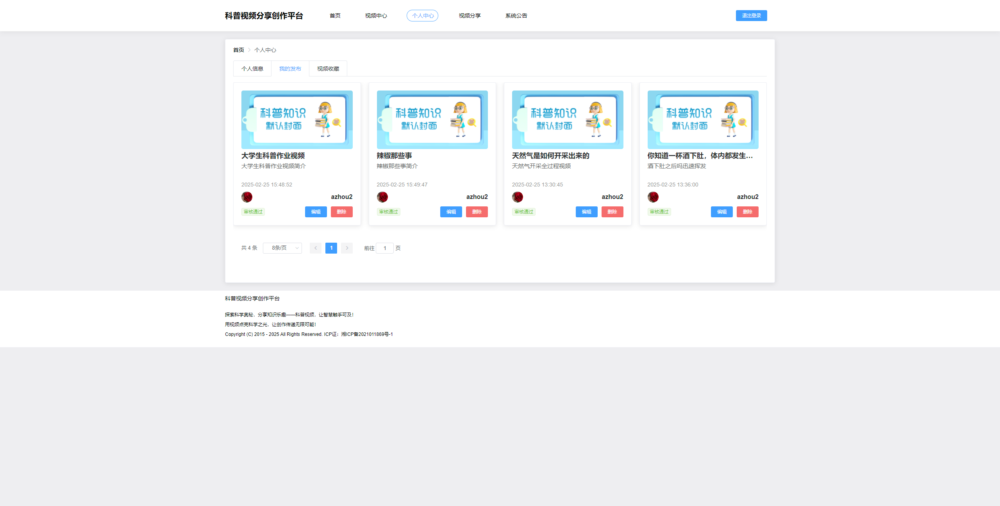

个人资料页：维护修改个人账号的基础信息

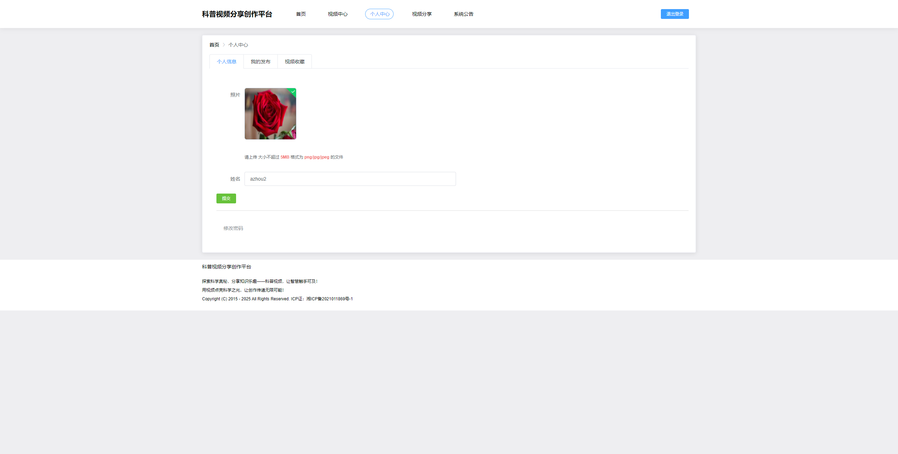

## 五、主要业务流程

1. 用户注册并登录用户端
2. 用户上传视频，视频状态设置为“待审核”
3. 管理员登录后台，查看待审视频列表
4. 管理员审核视频，选择“通过”或“驳回”
5. 若通过，视频在前台展示；若驳回，用户可在个人中心查看审核状态
6. 用户浏览视频、观看、点赞、收藏、评论
7. 管理员管理用户、评论、点赞、收藏等数据

## 六、项目拓展性

- 未来可增加教师或商家端角色，支持课程发布或商品推广场景
- 可引入视频推荐算法，提升用户体验
- 可扩展为多级审核流程，增加审核员与超级管理员权限分层
- 可接入第三方登录（微信、QQ）与支付系统，支持商业化运营

## 代码说明 
本仓库为项目的 **后端核心代码部分** 主要用于展示系统的业务设计思路与后端实现方式 出于学习展示与版权保护考虑 前端实现、完整数据库脚本及部署配置未在本仓库中公开 

##  项目交流 
本项目用于学习展示 如需项目完整功能演示、答辩说明或技术交流 请前往作者 GitHub 主页查看联系方式